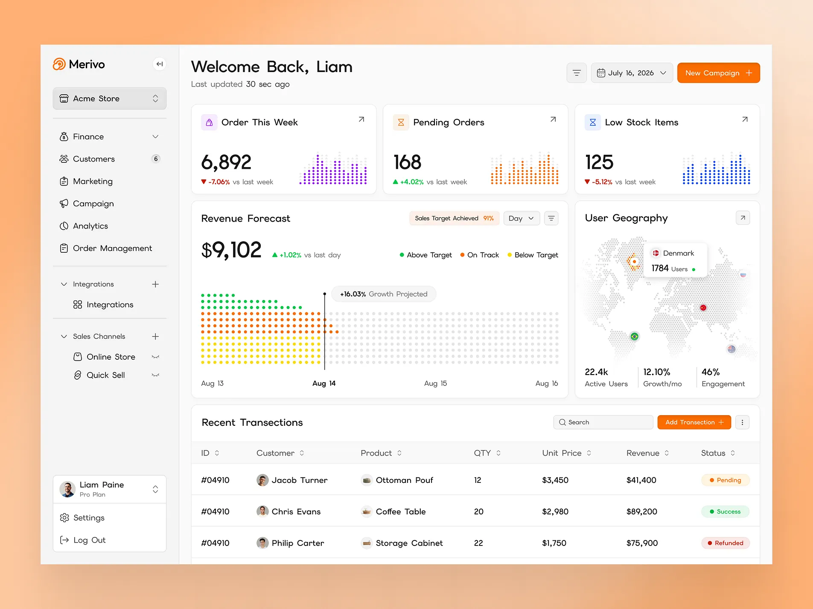
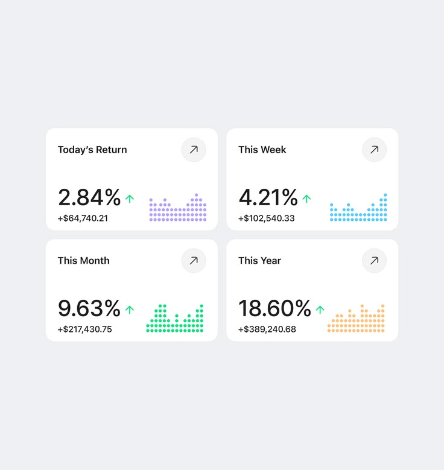

# WeConvert CRM — guideline UI de référence

Version 1.0 · 26 octobre 2026 · application CRM e-commerce COD · français LTR, arabe RTL à prévoir

> **Contrat visuel du produit.** Cette direction est la référence des écrans WeConvert CRM. Toute fonctionnalité ajoutée réutilise la même coque, les mêmes tokens, la même typographie, la même iconographie et les mêmes composants. Une évolution du style global demande une décision explicite du propriétaire ; une adaptation nécessaire pour la lisibilité, l’accessibilité ou une nouvelle taille d’écran se fait à l’intérieur de ce système. Le socle visuel est implémenté dans `src/visual.css` et `src/icon-registry.mjs` ; les sections décrivant les futurs modules restent des spécifications.

## 1. Cible, périmètre et niveaux de preuve

WeConvert est un CRM pour le paiement à la livraison en Algérie : commandes WooCommerce et saisie manuelle, confirmation téléphonique, rappels, stock, équipe, intégrations et, progressivement, livraison, messagerie, finances et attribution publicitaire. Le design sert des opérateurs qui passent des heures devant des listes et des fiches ; la lecture et la vitesse de traitement priment sur la décoration. Devise DZD/DA, wilaya/commune, français aujourd’hui et arabe/RTL lorsque l’interface sera localisée.

**Référence principale** : `references/ui/merivo-dashboard.webp`, image fournie, 1 905 × 1 429 px. Elle fixe la composition d’ensemble. **Référence secondaire** : `references/ui/kpi-cards.jpg`, image fournie, 736 × 779 px. Elle fixe le caractère des cartes KPI et du graphique en points. **Code existant à préserver fonctionnellement** : `src/style.css`, `src/crm.css`, `src/ui.js`, `src/crm.js`, `src/live-sync.mjs`, et le HTML approuvé `references/approved-frontend.html`. La capture `docs/realtime-active.png` documente la coque actuellement publiée, avant adoption de ce guide.





Les dimensions des images sont **relevées sur les fichiers**. Les rectangles, couleurs et caractéristiques typographiques ci-dessous sont **observés/estimés sur des captures**, sans accès au fichier Figma ni au CSS original. Toutes les valeurs CSS proposées sont **des décisions WeConvert**, et non des normes universelles de Stripe, Shopify ou WCAG. Les nombres des maquettes (6 892 commandes, 168 commandes en attente, revenus en dollars, etc.) ne sont pas des données WeConvert.

| Référence | Observation | Apport retenu | Adaptation WeConvert | À écarter |
| --- | --- | --- | --- | --- |
| Grand dashboard | Sidebar permanente, en-tête respirant, trois KPI, grande analyse à gauche, carte secondaire à droite, table pleine largeur | Architecture, densité homogène, proportions et accent orange | Navigation CRM existante et données COD réelles dans cette géométrie | Logo Merivo, noms anglais, dollars, prévision de revenu sans modèle, carte du monde sans données utiles |
| Quatre petites cartes | Grille 2 × 2, fond gris très clair, cartes blanches arrondies, gros taux, flèche circulaire, mini graphe en points colorés | Détails des KPI : nombre dominant, action discrète, micro-visualisation | Comparaison de périodes seulement si calculable ; libellés de confirmation, traitement et stock | Rendements financiers et pourcentages sans définition, quatre couleurs décoratives sans signification |
| Stripe Apps, documentation officielle | Composants et motifs réutilisables ; style contraint pour rester cohérent et accessible | Privilégier des composants communs et une marque concentrée | WeConvert garde **son** orange et **ses** composants | Copier l’identité Stripe ou prétendre que Stripe impose des dimensions en pixels |
| Shopify, documentation officielle | Grille d’espacement de 4 px, densité cohérente sur une page, cartes structurantes, une seule action primaire par carte | Rythme et gouvernance des écrans riches | Espacement WeConvert en multiples de 4, tables d’opérations lisibles | Copier Polaris visuellement ou remplacer Lucide par les icônes Shopify |

La vignette Merivo visible en ligne ne fournit pas de déclaration fiable de la police du fichier joint : **la famille exacte reste inconnue**. Le choix de `Outfit` ci-dessous est une **approximation visuelle proposée**, à confirmer si la source Figma ou le nom de la fonte deviennent disponibles.

## 2. Signature visuelle immuable

**Direction :** un poste de pilotage COD lumineux et précis, organisé comme la grande capture, avec cartes blanches généreuses, typographie géométrique, pictogrammes filaires homogènes et orange WeConvert réservé aux actions et aux signaux pertinents.

1. **Structure constante** : sidebar claire à gauche, zone principale en grille, en-tête et titres alignés sur la même marge ; mêmes cartes et mêmes rayons sur tous les modules.
2. **Hiérarchie des faits** : chaque carte commence par un libellé clair, montre un nombre ou un statut vérifié, puis un contexte temporel. Un joli graphique sans dénominateur, source ni période n’est pas affiché.
3. **Calme visuel** : blanc et gris dominent. Orange pour marque/action/attente, autres couleurs pour séries ou états sémantiques. Pas d’aplat orange derrière l’application : le dégradé pêche de la capture est une **mise en scène extérieure** à la fenêtre du produit.

### Proportions effectivement observées dans la grande image

Ces mesures concernent les **pixels de l’illustration**, pas le CSS originel. Fenêtre blanche ≈ x 95–1 809 et y 105–1 325, largeur ≈ 1 714. Sidebar ≈ 324 px dans cette illustration, soit ≈ 19 % de la fenêtre. La zone des cartes commence vers x 448. Première rangée : trois cartes d’environ 434 × 212 px avec environ 15 px entre elles. Deuxième rangée : grand panneau ≈ 884 × 464 px et panneau droit ≈ 435 × 464 px. La table occupe ensuite pratiquement toute la largeur disponible. L’autre image montre des cartes d’environ 286 × 170 px et un écart ≈ 14 px. Pour le produit, le **rapport de colonnes** compte davantage que ces pixels issus d’une composition graphique.

### Architecture desktop proposée

```text
Sidebar 256–272 px | contenu fluide avec marge 24–32 px
En-tête : titre et fraîcheur des données | filtres de période | action principale
KPI : trois colonnes égales, ou quatre en grille 2 × 2 si la page l’exige
Analyse : 2 parts | 1 part (second panneau métier réel)
Activité : table ou file sur toute la largeur
```

Le panneau droit ne montre une carte de wilayas que lorsque la géolocalisation des commandes est suffisamment fiable et agrégée. Avant cela, utiliser exactement le même gabarit pour « À traiter aujourd’hui » ou « Retards de confirmation ». Une projection ou prévision n’apparaît que lorsqu’un modèle explicable et la période source existent.

## 3. Fondations : couleurs et contraste

### Tokens proposés — thème clair

| Token CSS | Valeur | Rôle | Remarque |
| --- | --- | --- | --- |
| `--wc-canvas` | `#F7F7F8` | Fond de la zone de travail | Neutre, jamais pêche |
| `--wc-sidebar` | `#F5F5F5` | Navigation latérale | Séparation fine avec la zone principale |
| `--wc-surface` | `#FFFFFF` | Cartes, table, menus, modales | Surface principale |
| `--wc-ink` | `#111827` | Titres, nombres, texte courant | 17,74:1 sur blanc, contraste calculé |
| `--wc-muted` | `#59616C` | Aides, dates, sous-libellés | 6,27:1 sur blanc, calculé |
| `--wc-line` | `#E8EAED` | Séparateurs **décoratifs** | Trop faible pour être l’unique signe d’un champ |
| `--wc-control` | `#656D77` | Contour de champ quand nécessaire | 5,24:1 sur blanc, calculé |
| `--wc-brand` | `#F97316` | Logo, graphe décoratif, petits accents | **2,80:1 avec du texte blanc : interdit comme fond d’un CTA blanc** |
| `--wc-action` | `#B84308` | Bouton primaire avec texte blanc | 5,46:1 blanc/orange, calculé |
| `--wc-action-hover` | `#963506` | Survol de l’action | Visiblement plus sombre |
| `--wc-brand-soft` | `#FFF0E6` | Pastille de marque, sélection subtile | Texte orange foncé, jamais `--wc-brand` en petit corps |
| `--wc-focus` | `#1558B5` | Anneau de focus visible | Épaisseur 3 px, décalage 2 px |
| `--wc-success` | `#137C45` | Livré/confirmé selon le contexte | Sur `#E9F8EF` : 4,79:1, calculé |
| `--wc-warning` | `#986000` | En attente/à rappeler | Sur `#FFF4DC` : 4,80:1, calculé |
| `--wc-danger` | `#B42318` | Erreur, annulation, échec | Sur `#FFF0EE` : 5,93:1, calculé |
| `--wc-info` | `#1558B5` | Information et série bleue | Sur `#EAF1FF` : 5,99:1, calculé |
| `--wc-purple` | `#783AB4` | Série distincte dans les KPI | Sur `#F4ECFF` : 5,97:1, calculé |

Contrastes calculés selon la formule WCAG sur les **valeurs CSS proposées**. Ils ne prouvent pas à eux seuls la conformité du rendu final : superpositions, opacité, état disabled et anticrénelage doivent être audités après implémentation. WCAG 2.2 AA demande 4,5:1 pour le texte normal, 3:1 pour le grand texte et 3:1 pour les indicateurs non textuels nécessaires. Une bordure claire purement décorative peut rester subtile, mais un champ qui n’existe visuellement que par sa bordure doit utiliser un contour assez contrasté. La différence « hausse/baisse » garde signe et libellé, jamais la couleur seule.

### Tokens proposés — thème sombre, même géométrie

| Token CSS | Valeur | Règle |
| --- | --- | --- |
| `--wc-canvas` | `#111418` | Fond principal |
| `--wc-sidebar` | `#171B20` | Sidebar |
| `--wc-surface` | `#1D2228` | Cartes, table, champs |
| `--wc-ink` | `#F6F7F9` | Texte principal ; 14,94:1 sur la surface, calculé |
| `--wc-muted` | `#C1C9D2` | Texte secondaire ; 9,57:1 sur la surface, calculé |
| `--wc-line` | `#34404D` | Séparateurs décoratifs |
| `--wc-control` | `#A8B4C2` | Bords de champs nécessaires ; contrôler en contexte |
| `--wc-brand` | `#FF8A3D` | Accent et points du graphe |
| `--wc-action` | `#FF8A3D` | Bouton avec texte `#1D2228` ; 6,83:1 calculé |
| `--wc-focus` | `#8BB7FF` | Anneau de focus |

Le bouton « mode sombre » change **toutes les surfaces, textes, bordures, formulaires, tableaux, modales, badges et graphiques** ; il conserve les mêmes tailles et la même structure. Le choix utilisateur persiste. Vérifier les graphes et états d’erreur dans les deux thèmes ; ne pas appliquer un simple filtre CSS de luminosité.

### Règles de couleur métier

- Orange : action WeConvert et commandes qui exigent une attention ; une carte KPI orange ne signifie pas automatiquement une hausse.
- Vert : opération accomplie ou résultat positif **dans son contexte** ; une baisse des refus peut être positive, une hausse des retards ne l’est pas.
- Rouge : erreur, échec, annulation ou alerte bloquante ; le pourcentage négatif prend aussi une flèche et une explication.
- Bleu : information et série comparative ; violet : deuxième série de données. Jaune/orange : en attente. Un « statut » contient du texte lisible en plus de la couleur.
- Les mini graphiques en points sont décoratifs lorsqu’ils répètent une valeur déjà écrite ; s’ils véhiculent une tendance nouvelle, offrir période, valeurs accessibles et texte alternatif ou table de données.

## 4. Typographie : reproduire l’esprit de la capture

**Famille proposée : `Outfit`**, géométrique et ronde, proche de l’impression visuelle de la grande capture. **La police exacte de l’image n’a pas pu être identifiée** à partir des seuls pixels ; ne pas l’annoncer comme un fait. Si le fichier source démontre une autre police et que sa licence permet l’intégration, remplacer `Outfit` dans **un seul token**, puis revalider les métriques. Ne pas combiner plusieurs polices latines selon les écrans.

Police arabe proposée : **`Noto Sans Arabic`**, chargée pour les segments arabes ; prévoir une épreuve avec noms, wilayas, diacritiques et chiffres. `Outfit` n’est pas supposée couvrir l’arabe. CSS : `font-family: "Outfit", "Noto Sans Arabic", system-ui, sans-serif;` ; sur `[lang="ar"]`, mettre `Noto Sans Arabic` en premier. Pesées à charger : 400, 500, 600, 700 ; `font-display: swap`. Chiffres des tables/KPI : `font-variant-numeric: tabular-nums` ; montants `Intl.NumberFormat('fr-DZ')` ou format métier testé, unité `DA` explicite ; ne pas mélanger visuellement dinars et dollars.

| Usage | Desktop : taille / interligne / poids | Mobile : taille / interligne / poids | Règle |
| --- | --- | --- | --- |
| Titre d’écran H1 | 32–36 / 40–44 px / 500–600 | 28 / 36 px / 600 | Grand, une ligne si possible, retour naturel si nécessaire |
| Titre de carte H2 | 20–22 / 28 px / 500–600 | 18–20 / 28 px / 600 | Même hiérarchie sur chaque module |
| KPI dominant | 40–48 / 48–56 px / 600 | 32–40 / 40–48 px / 600 | Laisser l’unité respirer, `tabular-nums` |
| Libellé de KPI | 16–18 / 24 px / 500 | 16 / 24 px / 500 | Jamais amputé derrière l’icône |
| Corps, cellule, champ | 16 / 24 px / 400–500 | 16 / 24 px / 400–500 | Base confortable pour le travail continu |
| Secondaire/colonne/tableau | 14 / 20–22 px / 400–500 | 14 / 20–22 px / 400–500 | Éviter sous 14 px pour les informations nécessaires |
| Bouton primaire | 16 / 24 px / 500–600 | 16 / 24 px / 500–600 | Verbe précis, jamais tout en capitales |
| Badge/statut | 14 / 20 px / 500–600 | 14 / 20 px / 500–600 | Libellé + couleur, pas un point seul |

Les tailles 16/14/44 px sont des **choix de confort WeConvert**, pas des minima textuels universels imposés par WCAG. La page doit permettre le zoom texte à 200 %, le reflow à 320 CSS px et des titres longs sans troncature de sens. Dans les tableaux, autoriser la coupure des noms et des adresses, mais conserver les numéros de commande et les montants entiers.

## 5. Grille, espacements et dimensions des composants

Base de rythme 4 px : `4, 8, 12, 16, 24, 32, 40, 48`. Même densité standard à l’intérieur d’un écran ; ne pas mélanger une table ultra compacte et des cartes très aérées. Shopify documente cette grille de 4 px et recommande une densité cohérente, pas les dimensions précises ci-dessous.

| Élément | Desktop cible | Tablette cible | Mobile cible |
| --- | --- | --- | --- |
| Sidebar | 256–272 px, fixe, scrollbar interne | 240–256 px si place ; drawer à ≤ 1 024 px | Drawer 280 px max, fermer au changement de page |
| Topbar | hauteur minimale 72 px, padding 24–32 | 64–72 px | 60–72 px, actions secondaires dans menu |
| Zone de contenu | largeur max 1 520 px, marge 24–32 px | marge 20–24 px | marge 16 px ; 12 px à 320 px si besoin |
| Espace entre sections | 20–24 px | 16–20 px | 16 px |
| Cartes KPI | 3 colonnes, gap 16 px, hauteur min 184–208 px | 2 colonnes si contenu < 1 000 px | 1 colonne à 320–599 px ; 2 si largeur ≥ 600 px et texte tient |
| Carte analytique / secondaire | grille `minmax(0,2fr) minmax(280px,1fr)` ; hauteur utile ≈ 420–460 px | colonnes 1fr/1fr ou pile | pile verticale ; graphe prioritaire puis action |
| Carte ordinaire | padding 24 px ; rayon 14 px ; bord 1 px | padding 20 px | padding 16 px |
| Table | ligne min 60 px, en-tête 48 px ; 8–10 colonnes selon page | colonnes essentielles + horizontal local | fiche par commande ou table scrollable **dans son conteneur**, jamais page entière |
| Bouton principal / champ | hauteur min 44 px, padding horizontal 16 px | idem | hauteur 48 px pour actions fréquentes |
| Bouton icône seul | zone cliquable 44 × 44 px, dessin 20 px | idem | zone 44–48 px |
| Onglet / option de menu | min 44–48 px de haut | idem | min 48 px |
| Modal / tiroir | dialog ≤ 720 px ; tiroir ≈ 560–720 px selon fiche | max largeur fenêtre − 32 px | plein écran ou quasi plein écran avec en-tête et actions accessibles |

Règle responsive : à **≥ 1 440 px** afficher 3 KPI et le panneau 2:1 ; **1 024–1 439 px** garder le même langage avec 2 KPI par rangée si nécessaire ; **768–1 023 px** convertir la sidebar en drawer et empiler les panneaux complexes ; **< 768 px** présenter une seule colonne métier, filtres repliables et action principale visible. Ces seuils sont des cibles à tester, pas des obligations de Shopify. Utiliser `minmax(0,1fr)`, `overflow-wrap`, requêtes de conteneur quand utiles ; éviter de réduire le texte pour faire tenir trois cartes.

Une liste de commandes longue reste paginée et filtrable. À 320 px, aucun contenu utile, bouton, champ ou message d’erreur n’est coupé. Une table complexe peut défiler horizontalement **localement** avec un intitulé clair ; le reste de la page ne le fait pas. Tester 320, 360, 768, 1 024, 1 440 et 1 920 CSS px, puis zoom 200 % et 400 %.

## 6. Bibliothèque de composants obligatoire

| Composant | Aspect et dimensions | Comportement / états à spécifier |
| --- | --- | --- |
| Sidebar | Fond gris très clair, séparateur fin, logo WeConvert, boutique active en carte 44+ px, groupes sobres | actif fond `--wc-brand-soft` + texte foncé ; hover, focus, collapse sur tablette, compteurs réels ; pas de fausse navigation |
| En-tête | Titre de page à gauche, fraîcheur des données et filtres, CTA à droite | le badge « En direct » reste vrai : connexion, reconnexion, hors ligne et rattrapage sont distincts |
| KPI cliquable | Carte blanche 14 px, 1 px de bord, padding 24 ; carré icône 36–40 ; flèche discrète à droite ; gros nombre ; mini-dots en bas | toute la carte clique vers la vue filtrée ; hover par bordure/fond léger ; focus 3 px ; loading skeleton ; état vide « — » + explication, jamais `0` inventé |
| Carte graphique | Titre, filtre de période, nombre récapitulatif, légende ; points 5–7 px espacés régulièrement | tooltip clavier/souris avec date et valeur, période exacte, axe/étiquettes lisibles ; version table accessible ; éviter animation continue |
| Carte action métier | Même hauteur et mêmes bordures que le grand graphe voisin | liste de tâches concrètes, compteur, destination ; un seul bouton primaire par carte |
| Table CRM | En-tête neutre, lignes ≥ 60 px, séparateurs doux, valeurs alignées, code et montant tabulaires | tri indiqué, recherche, filtres, sélection, pagination, ouverture de fiche, loading, erreur, empty ; actions de ligne tertiaires, pas de CTA orange répétés |
| Badges | Pilule arrondie, texte 14 px, fond pâle et couleur foncée | libellés « Nouvelle », « À rappeler », « Confirmée », etc. ; icône/forme si distinction indispensable |
| Boutons | primaire orange foncé/texte blanc ; secondaire blanc/bordure ; tertiaire texte | normal, hover, focus, disabled expliqué, loading non double-cliquable, réussite/échec annoncé |
| Champ et filtre | hauteur ≥ 44 px, texte 16 px, label visible, aide sous le champ | valeur conservée lors du temps réel, erreurs attachées au champ, focus visible ; ne pas substituer placeholder au label |
| Tiroir commande | En-tête identité + statut, sections Client, Articles, Montant COD, Livraison, Attribution, Historique, Actions | annulation et édition confirmées selon logique métier ; appels/notes et brouillon préservés pendant mises à jour en direct ; fermeture sans perte silencieuse |
| Toast / état | titre clair et conséquence ; ≤ 1 primaire | succès après réponse serveur, erreur avec possibilité de réessayer, annonce accessible `aria-live` sans avalanche |
| État vide | Icône Lucide + phrase utile + action réelle | distinguer aucune donnée, filtre sans résultat, permission insuffisante et synchronisation en cours |

Les mini-dots ne servent pas de seul support à une métrique. Le contrôle de période alimente **tous les KPI et graphiques liés** ou indique clairement ceux qui ne sont pas affectés. « Dernière mise à jour » = horodatage de la dernière récupération terminée ; « En direct » = statut de souscription, pas promesse d’un délai WooCommerce inférieur à une seconde.

## 7. Icônes : Lucide comme unique jeu d’interface

Utiliser exclusivement les icônes de [lucide.dev/icons](https://lucide.dev/icons/) pour les actions et la navigation. Conserver le **logo WeConvert** comme marque, pas comme icône de navigation générique. Ne pas mélanger Lucide avec emoji, glyphes Unicode, Font Awesome, Heroicons ou dessins SVG maison ; un logo de transporteur ou de canal tiers peut rester un logo authentique, séparé du système d’icônes. Les points de graphe et les pastilles de statut sont des formes de données, pas des pictogrammes concurrents.

**Réglage WeConvert proposé** : icône 20 × 20 px en navigation, bouton et tableau ; 16 px pour chevrons intégrés ; 24 px dans une carte/état vide ; `stroke-width: 1.75` de base, `stroke-linecap: round`, `stroke-linejoin: round`, `color: currentColor`. Les icônes Lucide sont SVG, personnalisables et importables sélectivement ; les 20 px et 1,75 sont nos valeurs, tandis que la bibliothèque affiche 24 px et une épaisseur 2 par défaut. La **zone cliquable** reste ≥ 44 px même si le dessin n’en occupe que 20.

| WeConvert | Nom Lucide proposé | Usage |
| --- | --- | --- |
| Vue d’ensemble | `layout-dashboard` | nav et retour dashboard |
| Commandes | `shopping-bag` | nav, KPI commandes |
| Confirmation / appel | `phone-call` | actions téléphoniques réelles |
| Rappel | `clock-3` | échéance de rappel |
| Livraisons / retours | `truck` / `rotate-ccw` | modules distincts |
| Produits / stock | `package` / `boxes` | catalogue et disponibilité |
| Clients / équipe | `user-round` / `users-round` | personne vs équipe |
| Performance | `chart-no-axes-combined` | rapports, pas action de livraison |
| Finances | `wallet` | encaissements et rapprochement |
| Publicité / tracking | `target` / `activity` | attribution et événements |
| Messages / automatisations | `messages-square` / `workflow` | inbox et règles |
| Intégrations / boutique | `plug-zap` / `store` | connexions et boutique |
| Recherche / filtre / calendrier | `search` / `sliders-horizontal` / `calendar-days` | opérations standard |
| Créer / modifier / exporter | `plus` / `pencil` / `download` | actions standard |
| Statuts de connexion | `radio` / `wifi-off` / `refresh-cw` | live, offline, rattrapage |
| Thème / paramètres | `moon` / `sun` / `settings-2` | modes cohérents |
| Plus / fermer / ouvrir | `ellipsis` / `x` / `arrow-up-right` | contrôles secondaires |

**Implémentation pour ce dépôt JavaScript/HTML** : installer le paquet officiel `lucide` à une version verrouillée dans `package-lock.json`, importer uniquement les noms utilisés, générer les SVG via l’API vanilla documentée. Remplacer la map `ICONS` dessinée à la main dans `src/ui.js` progressivement, avec contrôle du nom de chaque icône ; ne pas reconstruire tout le DOM ni perdre les focus/événements lors d’un signal temps réel. Pas de CDN `@latest` en production. Le SVG décoratif porte `aria-hidden="true"` ; un bouton icône seul porte un vrai `aria-label`, par exemple « Ouvrir la commande ». Vérifier la présence des noms choisis dans la version effectivement installée.

## 8. Déclinaison exacte sur le CRM

### 8.1 Vue d’ensemble — écran de référence

En-tête « Votre activité, en un coup d’œil », indicateur « En direct », boutique et période. Rangée de **trois cartes au format de la grande capture** : « Commandes reçues », « À confirmer », « Taux de confirmation ». Chacune montre période, valeur réelle, comparaison uniquement si l’historique le permet et un mini graphe **si** les points existent. Un quatrième indicateur « Rappels à traiter » passe dans une grille 2 × 2 ou dans le panneau « Votre journée » selon l’espace. Le backend actuel sait compter ces indicateurs ; il ne suit pas encore les livraisons ni les encaissements effectifs.

Sous les KPI : graphe « Activité des commandes » sur 7/30 jours, fond en points inspiré des captures mais unités et légende explicites ; panneau droit « Votre journée » avec commandes à confirmer, rappels dus et confirmées. En bas : « Dernières commandes », table réelle pleine largeur. CTA « Nouvelle commande » crée une commande ; lien « Tout voir » ouvre `#orders`. Le montant confirmé se nomme **valeur COD confirmée**, jamais « chiffre d’affaires encaissé ».

### 8.2 Commandes

Même coque, titre et actions au même endroit. Onglets Tous, Nouvelles, En traitement, Confirmées, Annulées ; sous eux, grande carte table avec recherche, boutique/agent, tri et filtres. Ligne : numéro, canal d’origine, client/téléphone, produit(s), wilaya, montant COD, agent, statut et date. Les montants restent alignés et la ligne s’ouvre au clavier comme au clic. À l’arrivée temps réel, mettre à jour liste et compteurs sans déplacer la saisie, effacer la recherche ou fermer une fiche ; indiquer si la commande est hors filtre. Afficher en priorité une commande nouvelle si l’onglet courant la comprend ; ne pas modifier le tri choisi.

### 8.3 Confirmation

Au desktop : liste/file à gauche ≈ 34 %, dossier de la commande à droite ≈ 66 %, dans deux cartes du même langage visuel. Informations à lire avant appel : client, téléphone, wilaya/commune/adresse, produits, quantité, prix, remise, frais et total COD. Bloc d’actions Appeler / statut / rappel / note avec libellés et confirmations cohérents. Historique en séquence lisible ; un événement « WooCommerce mis à jour » n’efface pas les notes ni le prix convenu. Sur mobile : file puis fiche plein écran, retour à la position de file, actions utiles proches du contenu sans masquer le clavier. La réception d’une autre commande n’interrompt pas l’appel ou le brouillon ouvert.

### 8.4 Produits et stock

Cartes KPI si utiles (produits actifs, disponibles, sous seuil) calculées depuis le vrai stock. Grande table : produit, SKU, physique, réservé, disponible, prix et action. L’état « Stock indisponible » est un badge explicite ; `0` est distinct de « non synchronisé ». Les variantes et bundles attendent un modèle métier réellement branché ; ne pas les dessiner comme des contrôles opérationnels fictifs.

### 8.5 Équipe, intégrations et paramètres

- **Équipe** : liste membres/rôle/accès, CTA Inviter ; différences propriétaire/admin/agent visibles ; aucune action affichée si le rôle ne la permet pas.
- **Intégrations** : statut WooCommerce réel, dernière synchronisation, erreurs actionnables, événements récurrents ; bouton reconnecter/diagnostiquer si implémenté. Une carte d’intégration reprend le même padding, rayon, titre et badge que les autres.
- **Paramètres** : groupes de réglages en sections, description à gauche/champ à droite sur large écran, empilés sur mobile ; le sélecteur sombre/clair fait apparaître un vrai changement de tokens.

### 8.6 Modules futurs dans **la même UI**, seulement lorsqu’ils sont codés

| Module | Structure visuelle fixe | Métrique/état indispensable avant affichage |
| --- | --- | --- |
| Livraisons et retours | KPI + table + fiche latérale | statuts transporteur réellement reçus, horodatés |
| Clients | recherche + table + fiche historique | dédoublonnage et données autorisées pour le rôle |
| Finances | KPI + rapprochement + détail | COD réellement encaissé, frais et source comptable |
| Publicité / tracking | KPI + tableau campagnes + entonnoir | sources UTM et identifiants de clic ; événements Pixel/CAPI dédupliqués ; confirmé vs livré séparés |
| Messagerie | liste de conversations + fil + fiche commande | canal officiellement connecté, permissions et envoi réels ; saisie manuelle de commande message conservée |
| Automatisations | liste des règles + journal + édition | règles réellement exécutées et auditables |

Une entrée « À venir » peut exister dans la navigation mais doit rester clairement non opérationnelle. **Ne jamais remplir le dashboard de faux ordres, faux revenus, faux transporteurs ou pourcentages d’attribution.** Réutiliser les mêmes composants plutôt que recréer une UI pour chaque fonctionnalité.

## 9. Rédaction de l’interface et données COD

Libellés français courts et concrets : « À confirmer », « Rappel aujourd’hui », « Valeur COD confirmée », « En attente d’envoi », « Dernière mise à jour à 14:32 », « Aucune commande pour ce filtre », « Réessayer la synchronisation ». Les sources « WooCommerce », « WhatsApp (saisie manuelle) », « Messenger (saisie manuelle) », « Instagram (saisie manuelle) », « Téléphone » restent distinctes d’un canal de messagerie officiellement connecté.

Afficher `4 600 DA` dans les tableaux, dates en heure d’Alger, et le montant total à percevoir sans l’appeler « payé » tant qu’il n’est pas encaissé. Un téléphone se présente comme un numéro, avec direction LTR isolée même en page arabe. Les noms et adresses en arabe prennent `lang="ar" dir="auto"` au niveau du contenu ; la page arabe complète prend `dir="rtl"`, propriétés CSS logiques, navigation et chevrons directionnels adaptés. Ne jamais retourner les logos, nombres, produits ou graphiques par `transform: scaleX(-1)` pour simuler le RTL.

Exemples d’états : « Connexion en cours… », « En direct », « Reconnexion… », « Hors ligne · dernières données enregistrées à 14:32 ». Erreur d’intégration : « WooCommerce n’a pas transmis cette commande. Vérifiez l’état des webhooks. » uniquement quand ce diagnostic a effectivement été établi. Confirmation : « Commande confirmée, stock réservé. » uniquement après succès serveur. Les erreurs conservent les champs saisis et montrent un prochain geste utile.

## 10. Accessibilité, performance et QA

Norme visée : **WCAG 2.2 AA** sur les écrans livrés. Les liens/boutons nécessaires ont une cible confortable de 44–48 px ; WCAG 2.2 AA fixe **24 × 24 CSS px ou une exception de spacing** comme minimum normatif, tandis que 44 px est notre choix produit. Contraste cible 4,5:1 texte normal, 3:1 grand texte et informations non textuelles nécessaires ; focus visible 3 px ; zoom 200 % pour le texte, reflow 320 CSS px hors exceptions pour les tableaux réellement bidimensionnels. Labels, intitulés de colonnes, nom accessible des actions icône et messages d’erreur sont vérifiés au clavier et au lecteur d’écran. Réduire les animations sous `prefers-reduced-motion` ; ne pas rendre la réception en direct clignotante.

Le rendu ne doit pas dépendre d’une image aplatie du dashboard : HTML, CSS, SVG et texte restent réels. Charger la fonte avec `font-display: swap`, seulement les graisses/langues utiles ; importer les icônes Lucide à l’unité ; dimensionner les cartes et graphiques pour éviter le déplacement de contenu. Revalider la mise à jour temps réel après toute modification du DOM, car les régions partielles actuelles protègent recherche, sélection, modales et brouillons.

### Critères de réception de la future implémentation

| Contrôle | Résultat attendu | Statut aujourd’hui |
| --- | --- | --- |
| Fidélité | Sidebar / entête / KPI / grille 2:1 / table reflètent la grande image ; KPI suivent la petite | À implémenter et comparer |
| Coque unique | Tous les écrans actifs réutilisent palette, police, cartes, champs, boutons et Lucide | À implémenter |
| Fonctionnel | Commande, confirmation, filtres, rôles, Woo et Realtime continuent de fonctionner | À revalider après adaptation |
| Mesures | Aucun montant livré/encaissé ou pourcentage sans source et formule | À vérifier écran par écran |
| Responsive | Aucun débordement global à 320/360/768/1 024/1 440/1 920 px | À tester |
| Mode sombre | Chaque surface et chaque état change, sans perte de contraste ni structure | À tester |
| Accessibilité | Focus, clavier, ordre DOM, étiquettes, contrastes, zoom et RTL lorsque disponible | À auditer |
| Régression visuelle | Captures de référence desktop/mobile, clair/sombre comparées à chaque changement d’interface | À installer après première implémentation |

### Règle de maintenance « garder ce UI »

Pour chaque fonctionnalité future : 1) repérer le gabarit existant ; 2) réutiliser tokens et composants ; 3) étendre le jeu Lucide si nécessaire avec une entrée nommée ; 4) tester au moins un desktop, un mobile et les deux thèmes ; 5) comparer captures avant/après ; 6) corriger la dérive sans changer les flux métier. Une demande de nouveau module n’autorise **aucune refonte spontanée** de la navigation, de la police, des couleurs ou des cartes. Une exception d’accessibilité doit être documentée et appliquée à tout le système concerné.

## 11. Inventaire des assets et sources

| ID | Fichier | Provenance / dimensions | Usage | Limite |
| --- | --- | --- | --- | --- |
| REF-01 | `references/ui/merivo-dashboard.webp` | Pièce fournie, 1 905 × 1 429, ≈ 126 Ko | Planche principale de composition | Capture raster, interactions et valeurs CSS d’origine inconnues |
| REF-02 | `references/ui/kpi-cards.jpg` | Pièce fournie, 736 × 779, ≈ 26 Ko | Détail des quatre KPI | Pas de mobile/hover/dark ni source typographique |
| EXIST-01 | `docs/realtime-active.png` | Capture du frontend WeConvert avant adaptation | Contrôle des fonctions et de la continuité du projet | Ne sert pas de référence stylistique prioritaire |

Sources consultées le 26 octobre 2026 :

- Stripe Apps, [Design your app](https://docs.stripe.com/stripe-apps/design) : composants/patterns, cohérence du Dashboard, personnalisation de marque circonscrite.
- Shopify, [Layout](https://shopify.dev/docs/apps/design/layout) : 4 px, densité cohérente, cartes, table et structure responsive ; [Visual design](https://shopify.dev/docs/apps/design/visual-design) : hiérarchie, contraste et couleurs sémantiques.
- Lucide, [catalogue](https://lucide.dev/icons/) et [guide Vanilla JavaScript](https://lucide.dev/guide/lucide) : noms et intégration des pictogrammes.
- W3C, [WCAG 2.2 : contraste texte](https://www.w3.org/WAI/WCAG22/Understanding/contrast-minimum.html), [contraste non textuel](https://www.w3.org/WAI/WCAG22/Understanding/non-text-contrast.html), [cibles](https://www.w3.org/WAI/WCAG22/Understanding/target-size-minimum.html) et [reflow](https://www.w3.org/TR/WCAG22/#reflow).
- Google Fonts, [Outfit](https://fonts.google.com/specimen/Outfit) et [Noto Sans Arabic](https://fonts.google.com/noto/specimen/Noto+Sans+Arabic), choix proposés, **pas identification certaine** de la police de REF-01.

## 12. Prompt de transmission autonome pour l’adaptation du frontend

> Utilise le guide `docs/WECONVERT_GUIDELINES_UI.md` et les deux images `references/ui/merivo-dashboard.webp` et `references/ui/kpi-cards.jpg` pour adapter **le frontend existant de WeConvert CRM** dans ce dépôt. La grande image est la source principale de composition ; la seconde fournit les détails des KPI. Stripe et Shopify ne sont que des références de méthode et d’ergonomie, Lucide est l’unique jeu d’icônes d’interface.
>
> Préserve les parcours existants et leurs données : WooCommerce, commandes, confirmation, stock, équipe, intégrations, rôles, mode sombre et Realtime. Ne recrée pas un dashboard statique parallèle et ne réécris pas l’application à partir de la capture. Implémente d’abord les tokens clair/sombre, la famille proposée Outfit (sans prétendre que c’est la fonte exacte de l’image), la coque sidebar/topbar et trois cartes KPI ; applique les mêmes composants aux commandes, à la confirmation, aux produits, à l’équipe, aux intégrations et aux paramètres. Convertis les SVG d’interface maison à Lucide, avec imports sélectifs. Garde les logos de marque distincts.
>
> Les valeurs de la capture sont fictives pour WeConvert. N’affiche que des chiffres disponibles dans le backend, avec période et définition. Aucune livraison, finance ou attribution « opérationnelle » sans source réelle. Préserve les brouillons et focus pendant les mises à jour live. Conserve la langue française et les montants en DA ; prépare l’arabe/RTL sans renverser les contenus. Vérifie 320, 360, 768, 1 024, 1 440 et 1 920 px, clavier, contraste, zoom, clair et sombre. Livre le code, les captures de comparaison et les tests fonctionnels adaptés ; signale précisément les données indisponibles et les écarts de fidélité. Toute nouvelle fonction suit ensuite le même système visuel, sans refonte spontanée.

